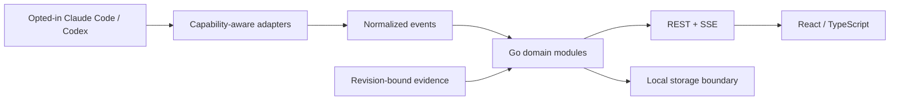
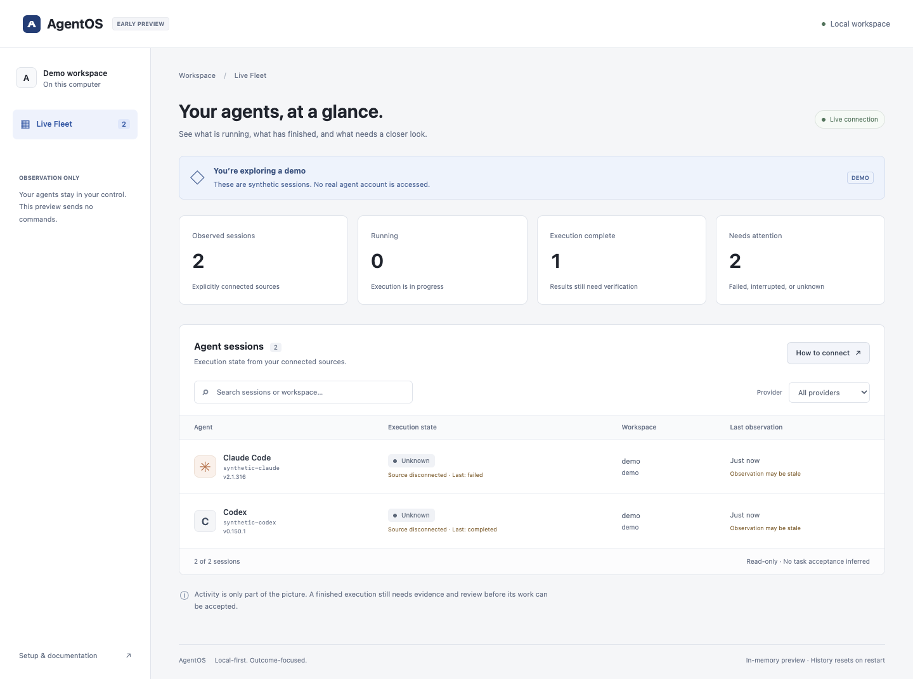

# AgentOS

**Manage AI coding agents by outcomes, not just activity.**

AgentOS is a planned local-first control center for Claude Code, Codex, and eventually other agents. Its goal is to answer: what is running, what is blocked, how much capacity is available, and which results have actually been verified?

> **Status: early local preview.** A Go backend and React/TypeScript screen now run locally with a two-provider synthetic demo or one explicitly selected metadata stream. There is no durable history, automatic discovery, provider control, or released compatibility guarantee.

## Product direction

- **Live Fleet:** observe opted-in agent sessions with source and freshness information.
- **Workload Intelligence:** distinguish execution slots, queue depth, blocked time, and verified progress. Unknown data stays unknown.
- **Proof of Work:** link acceptance criteria to a particular revision, checks, artifacts, and review. An agent saying “done” is not acceptance.
- **Later:** dependency graphs, structured handoff, and explicitly authorized controls.

The first target is a single-user macOS/Linux experience without an AgentOS account or mandatory cloud service. Agent providers retain their own authentication and usage requirements. Automatic discovery of every existing session is a hypothesis to validate, not a promised feature.

## Architecture direction

Go modular monolith + React/TypeScript UI; REST and SSE are the initial API direction. SQLite is the local storage candidate; PostgreSQL is reserved for a later server mode. The preview uses only the approved minimal React/TypeScript/Vite packages and Go standard library. No database driver has been installed.



## Try Live Fleet

Requirements: Go 1.26+, Node 22.12+ and npm.

```sh
git clone https://github.com/Aazernajaf/agentos.git
cd agentos
npm --prefix apps/web ci
npm --prefix apps/web run build
go run ./cmd/agentos --demo
```

Open the printed loopback URL. Demo sessions are synthetic; no provider account or model call is used. [Connection instructions and limitations](docs/architecture/live-fleet.md) explain explicit source input and the local security boundary. No database or migrations are required.



## Permission and completion kernel

A separate Go kernel gates registered operations and task acceptance: scoped authority, exact approvals, pinned skill/SOP/policy versions, trusted checks, revision-bound receipts and explicit review policy. It does not intercept external CLI tools. Fleet observation stays read-only; optional host-configured project review adds explicit operator acceptance.

```sh
go run ./cmd/agentos-policy-demo
```

This executable tests real gate paths with synthetic in-memory effects only; it performs no migration, provider control or model call. [Trust boundary, integration and limitations](docs/architecture/governance.md).

An experimental [owned provider check harness](docs/architecture/adapter-gates.md) connects these gates to Codex/Claude CLI runners. Offline gates and fixed synthetic goals pass for both pinned provider versions. This is not general coding-task acceptance. Fleet observation remains read-only. OpenClaw stays optional.

[Real project submission review](docs/architecture/project-task-review.md) verifies operator-selected output hashes and executes required project tests. Passing evidence remains pending until explicit operator confirmation in the local terminal or the configured Fleet review panel; source/output/test changes invalidate it. No model call is required.

## Development checks

```sh
go test -race ./...
go vet ./...
npm --prefix apps/web run typecheck
npm --prefix apps/web run build
python3 scripts/check_foundation.py
python3 scripts/check_agent_skills.py
python3 -m unittest discover -s scripts/agents -p 'test_*.py'
python3 -m unittest discover -s scripts/probes -p 'test_*.py'
git diff --check
```

Go uses only its standard library. Frontend packages are pinned in a lockfile. See [Contributing](CONTRIBUTING.md) before adding tooling or dependencies. Do not run paid/live feasibility probes as routine tests.

## Documentation

- [Permission and completion kernel](docs/architecture/governance.md)
- [Agent operating rules, skills and SOPs](docs/agents/skills.md)
- [Live Fleet preview: run, connect, security and API](docs/architecture/live-fleet.md)
- [Product scope and roadmap](docs/product/strategy.md)
- [Architecture and domain boundaries](docs/architecture/overview.md)
- [Adapter feasibility and validation plan](docs/architecture/adapters.md)
- [Executed adapter experiments](docs/architecture/adapter-experiments.md)
- [Event contract draft](docs/architecture/events.md)
- [Architecture decisions](docs/adr/README.md)
- [Threat model](docs/security/threat-model.md)
- [Phase 0 audit and handoff](docs/handoff/phase-0.md)
- [Contributing](CONTRIBUTING.md), [security reporting](SECURITY.md), [community conduct](CODE_OF_CONDUCT.md)
- [Agent instructions](AGENTS.md) and [Claude Code entry point](CLAUDE.md)

## License

License selection is pending maintainer approval. Apache-2.0 is the candidate from product planning; this repository does not yet grant an open-source license. Do not treat public visibility as permission to redistribute. Choosing a license is a public-release blocker.
