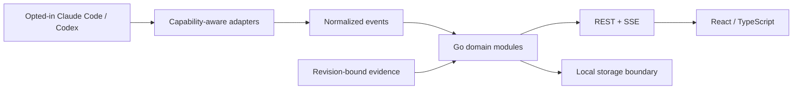

# AgentOS

**Manage AI coding agents by outcomes, not just activity.**

AgentOS is a planned local-first control center for Claude Code, Codex, and eventually other agents. Its goal is to answer: what is running, what is blocked, how much capacity is available, and which results have actually been verified?

> **Status: Phase 0 — foundation and feasibility.** This repository contains foundation documentation, repository checks, and opt-in synthetic provider feasibility probes. There is no runnable backend, frontend, installer, database, or implemented adapter yet. No release or compatibility guarantee is available.

## Product direction

- **Live Fleet:** observe opted-in agent sessions with source and freshness information.
- **Workload Intelligence:** distinguish execution slots, queue depth, blocked time, and verified progress. Unknown data stays unknown.
- **Proof of Work:** link acceptance criteria to a particular revision, checks, artifacts, and review. An agent saying “done” is not acceptance.
- **Later:** dependency graphs, structured handoff, and explicitly authorized controls.

The first target is a single-user macOS/Linux experience without an AgentOS account or mandatory cloud service. Agent providers retain their own authentication and usage requirements. Automatic discovery of every existing session is a hypothesis to validate, not a promised feature.

## Architecture direction

Go modular monolith + React/TypeScript UI; REST and SSE are the initial API direction. SQLite is the local storage candidate; PostgreSQL is reserved for a later server mode. No runtime packages or database drivers have been selected or installed.



## Start contributing

There is no application quick start yet. To inspect the foundation:

```sh
git clone https://github.com/Aazernajaf/agentos.git
cd agentos
python3 scripts/check_foundation.py
python3 -m unittest discover -s scripts/probes -p 'test_*.py'
git diff --check
```

The repository check uses only Python's standard library. Go/React tests and lint will be added with their implementation and approved tooling; they do not exist today.

## Documentation

- [Product scope and roadmap](docs/product/strategy.md)
- [Architecture and domain boundaries](docs/architecture/overview.md)
- [Adapter feasibility and validation plan](docs/architecture/adapters.md)
- [Executed adapter experiments](docs/architecture/adapter-experiments.md)
- [Event contract draft](docs/architecture/events.md)
- [Architecture decisions](docs/adr/README.md)
- [Threat model](docs/security/threat-model.md)
- [Phase 0 audit and handoff](docs/handoff/phase-0.md)
- [Contributing](CONTRIBUTING.md), [security reporting](SECURITY.md), [community conduct](CODE_OF_CONDUCT.md)
- [Agent instructions](AGENTS.md) and [Claude Code entry point](CLAUDE.md)

## License

License selection is pending maintainer approval. Apache-2.0 is the candidate from product planning; this repository does not yet grant an open-source license. Do not treat public visibility as permission to redistribute. Choosing a license is a public-release blocker.
